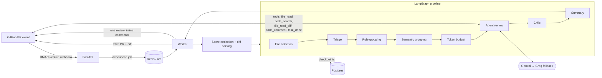

# Nirvachanam — Multi-Agent AI Code Reviewer

Nirvachanam is a GitHub App that reviews pull requests automatically. When a PR is opened or updated, it reads the diff, decides what is worth reviewing, runs an LLM agent that can look around the repository, checks the agent's findings, and posts **one review with inline comments** on the PR.

It is built so the LLM only does work that code can't. File selection, triage, rule matching, budgeting, finding verification and summary formatting are all ordinary code that uses **zero tokens**.

The same reviewer is also available as an **MCP server**, so Claude Desktop, Claude Code, Cursor or any other MCP client can call it directly.

## Architecture



| Stage | What it does | LLM tokens |
|---|---|---|
| Secret redaction | Replaces API keys, tokens and private keys with `[REDACTED:type]` before any model sees the diff | 0 |
| File selection | Drops lockfiles, vendored, generated, binary and oversized files (matched anywhere in the tree) | 0 |
| Triage | Sorts the PR into a `fast`, `standard` or `deep` tier; security-sensitive paths raise the tier | 0 |
| Rule grouping | Batches files that share rule packs (Python, JS/TS, Java, Go, Rust, SQL, config) | 0 |
| Semantic grouping | Groups related files so they are reviewed together (uses the LLM only for large PRs, and only on file metadata) | low |
| Token budget | Estimates token use and cost before any LLM call | 0 |
| **Agent review** | A tool-use loop: the LLM reads files, searches code, reads other files' diffs and records comments until it calls `task_done` or runs out of budget | ✔ |
| Critic | Verifies each finding against the diff, removes duplicates and drops prompt-injection echoes | 0 |
| Summary | Formats the review body from a template | 0 |

### Reliability and safety
- **Debounce and idempotency.** Rapid pushes collapse into one review. A commit that has already been reviewed is skipped, and a stale commit (when the PR head has moved on) is never reviewed.
- **Quota-aware fallback.** Transient errors retry. An exhausted provider is skipped without spending a call. Hard errors fail fast.
- **Diffs that can't be parsed are reported** on the PR as a comment instead of being silently treated as "nothing to review".
- **Tool-argument repair** fixes malformed tool calls from the LLM deterministically before retrying.
- **Postgres checkpointing** lets an interrupted run resume where it stopped.

## Quick start

```bash
cp .env.example .env        # fill in GitHub App + at least one LLM key
docker compose up -d        # api, worker, postgres, redis
```

Or run it without Docker:

```bash
uv venv && uv pip install -e ".[dev]"
uvicorn src.main:app --reload            # webhook API on :8000
arq src.queue.worker.WorkerSettings      # review worker
```

### GitHub App setup
1. Create a GitHub App with these **Pull requests** permissions: *Read & write*. **Contents**: *Read*.
2. Subscribe it to **Pull request** events, and set the webhook URL to `https://<host>/webhook/github`.
3. Put the App ID and webhook secret in `.env`, and save the private key as `private-key.pem`. Both files are gitignored and dockerignored.

## MCP server

```bash
python -m src.mcp_server     # stdio transport
```

| Tool | Description |
|---|---|
| `preview_review` | Free plan for a diff: which files would be reviewed, which tier, estimated cost |
| `scan_secrets` | Finds leaked credentials in text or a diff and reports their line and type, never the value |
| `review_diff` | Full multi-agent review of a unified diff (for example, `git diff` output) |
| `review_pull_request` | Reviews a GitHub PR. Set `post_review=true` and pass `installation_id` to post the findings inline |

To use it from Claude Code:

```bash
claude mcp add nirvachanam -- python -m src.mcp_server
```

To use it from Claude Desktop, add this to `claude_desktop_config.json`:

```json
{
  "mcpServers": {
    "nirvachanam": {
      "command": "C:/path/to/Pr_review_agent/.venv/Scripts/python.exe",
      "args": ["-m", "src.mcp_server"],
      "cwd": "C:/path/to/Pr_review_agent"
    }
  }
}
```

## Tests

```bash
pytest -q
```

The suite covers diff parsing, file selection, the rule engine, redaction, HMAC verification, the webhook, run identity, line resolution, the worker's end-to-end flow (GitHub and the LLM are mocked) and the MCP tools.

## Project layout

```
src/
  webhook/     HMAC verification + event filtering
  queue/       debounce, arq worker (end-to-end review job)
  diff/        unified-diff parser, comment line resolver
  graph/       LangGraph pipeline, nodes, checkpointer, large-PR handling
  agents/      file selection, triage, grouping, budget, agent loop + tools, critic
  rules/       per-language rule packs
  llm/         Gemini / Groq providers, quota tracker, fallback router
  github/      App auth client, review/comment builders
  security/    pre-LLM secret redaction
  mcp_server.py
```

## Roadmap
- **Evals:** a benchmark of PRs with known bugs to measure precision and recall of findings, and to compare prompts and models.
- Per-repository `.reviewrules.yaml` overrides.
